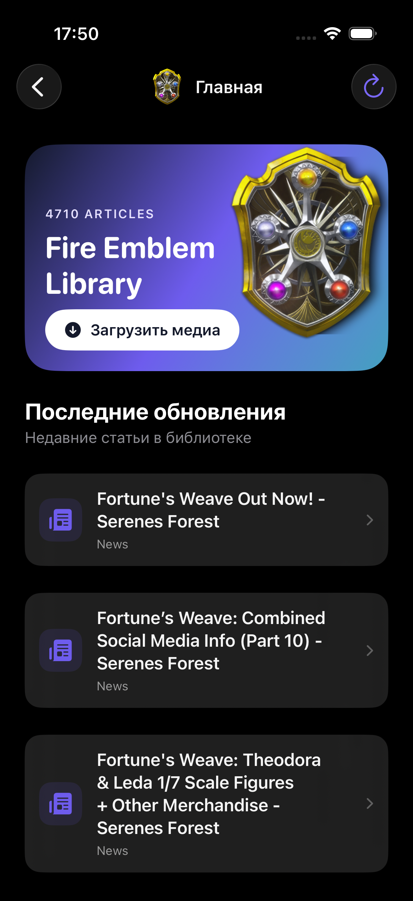
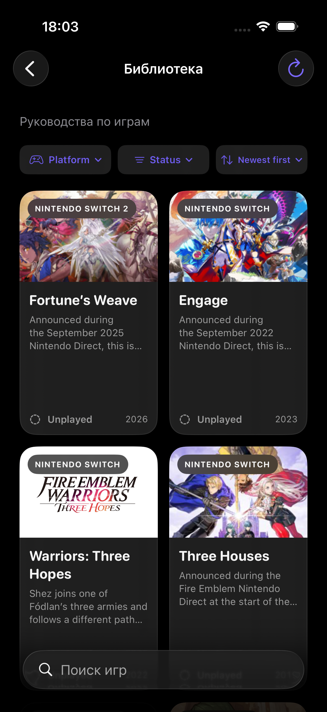
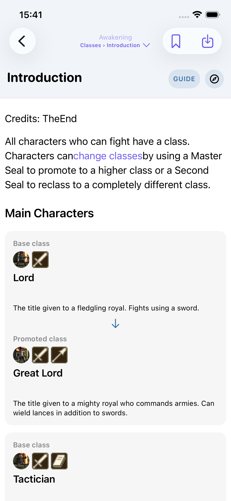

# Serenes Forest Companion

Native SwiftUI reference app for iOS 17+ and macOS 14+. Its distributable app already contains a populated SwiftData store with articles, game indexes, and media. On a new installation the app copies that store to writable application storage; it does not parse seed JSON or download initial content. Articles are displayed as native text, lists, images, and horizontally scrolling tables. Each article retains a link to its source page. Sitemap dates let the app add new articles and update changed ones in its database.

| Discover | Game library | Class promotions |
| --- | --- | --- |
|  |  |  |

Install Git LFS and pull the preloaded library before building (`git lfs install && git lfs pull`). Open `SerenesForest.xcodeproj` in Xcode and run the **SerenesForest** scheme for an iPhone simulator or **My Mac**. The project includes one local Swift package and requires no third-party runtime dependencies or account. See [Quick start](docs/QUICKSTART.md) for the build steps and repository layout.

## Architecture

The project follows the feature folders and local package approach used in `seller-app-ios`, scaled to this app:

| Location | Responsibility |
| --- | --- |
| `Sources/LocalPackages/SerenesParsing` | Independent SwiftPM module for URL canonicalization, HTML and RSS parsing, and sitemap XML parsing. It has no dependency on SwiftUI or SwiftData. |
| `Sources/Domain` | SwiftData library models and native article models. |
| `Sources/Parsing` | Native article tree and block parsing. |
| `Sources/Mapping` | Conversion of parsed content into library records, category and game overview mapping, and article translation mapping. |
| `Sources/Data` | Build-time content import, network sync, and image loading. |
| `Sources/Screens/<Feature>` | Feature views and their separate `@Observable` view models. |
| `Sources/Shared` | Reusable presentation components and styling. |
| `Sources/App` | Model container setup and the application entry point. |

Views render state and handle navigation. View models own screen state, filtering, sorting, pagination, translation, and article/media preparation. The sync service is `@Observable` and is injected through SwiftUI's environment. User-facing static text is kept in file-local `Constants`; they resolve with the language selected in Settings so the existing localization still applies. View files stay under 300 lines, and view models stay under 500 lines.

Run `swift test --package-path Sources/LocalPackages/SerenesParsing` to check the standalone parsing module.

## Preloaded library

`Resources/PreloadedLibrary` is the distributable SwiftData store and its external media storage. It currently contains 4,705 pages, 25,177 media records, 22 games, and 1,269 wiki-to-game links. The app bundle contains this store directly; the large source JSON/JSONL files are not included in the Xcode project or repository.

To refresh it, generate the five source files in the ignored `BuildContent/` directory using the scripts below, then run `python3 scripts/build_preloaded_library.py` on macOS. You can keep these large inputs outside the project and set `SERENES_SOURCE_CONTENT_DIR` to their directory. The build script optimizes large JPEG gallery images with ImageIO (maximum 3,200 pixels, quality 0.82), retaining the original whenever the saving is below 10%. It keeps PNG maps and transparent art, GIF, and WebP unchanged. The optimized JSONL files are temporary build inputs; only the finished SwiftData store is bundled. The script builds the app, imports all content into a fresh store, checks its integrity and record counts, and replaces `Resources/PreloadedLibrary`. Rebuild the iOS/macOS app afterward. Existing installations retain their writable library, bookmarks, translations, and downloaded updates; new installations start from the refreshed bundled store.

The app icon and Discover header use the Shield of Flames render from [Fire Emblem Wiki](https://fireemblemwiki.org/wiki/File:FEWA_Shield_of_Flames_complete.png). The wiki identifies it as copyrighted official artwork; its file page documents the source and usage rationale. Run `swift -module-cache-path /private/tmp/serenes-swift-module-cache scripts/build_app_icon.swift` from the project root to regenerate all app icon sizes from the bundled image.

For a physical iPhone or signed Mac build, choose your Apple development team and replace the example bundle identifier in the target settings.

## Content and sync

- The bundled database was generated from the source site, with public Wayback captures as a fallback. Each game's guide follows the section names, order, and topic lists saved from that game's main page. Sections appear as two or three columns of cards; opening a card shows its topics directly below that row. Text-only placeholders without links are omitted. Three Houses **About the Game** opens the saved game overview. When a main page is updated, its menu changes with it. Sitemap checks can discover later additions.
- The 22 game cards use selected artwork from the bundled site and its spin-off wiki. These small covers are packaged separately so they appear immediately; `python3 scripts/build_game_covers.py` regenerates the main-series covers from `BuildContent/SeedAssets.jsonl`. Guide cards show small images taken from each game's articles, with the cover as a fallback; `python3 scripts/build_section_art.py` regenerates those images. Article rows and headings use icons chosen from their content.
- Game cards show short story excerpts from each locally saved overview. The game screen keeps the full introduction alongside a compact status menu; existing "Playing" values appear as "In progress" and update when selected. One unrelated advertising paragraph in the archived Fates overview is ignored when building the game description.
- The library can sort games by title, release date, or status and filter them by status. Release years appear on library cards. **Settings** offers English and Russian. On iOS 18+ and macOS 15+, opening a game or article in Russian translates its navigation labels, article title, paragraphs, lists, image captions, and table cells with Apple's Translation framework. **Translate saved articles** in Settings processes the whole saved library while that screen stays open, shows progress, and resumes from saved fragments after interruption. Translation results are reused until the source page changes. The system may need to download its English–Russian language package on first use. Apple Translation does not run in the iOS simulator; there the app shows saved translations when available or the original article with a brief notice, without opening the system's unsupported translation sheet. Older OS versions continue to display the original article. Source links, images, and table structure are preserved.
- Game screens have a separate Fire Emblem Wiki block with 1,135 native articles covering characters, chapters, acts, classes, mechanics, and game worlds across 21 games plus series-wide topics. Chapter and act categories are imported in full for the main games; the continuously growing Heroes category is capped at 48 chapter pages plus its index. Shared articles appear under every relevant game, including remakes. Chapters follow each game's wiki chapter index and show their chapter or act number; maps within an act follow the order linked from the parent article. The separate **Fire Emblem Wiki** sidebar section searches all preloaded wiki articles. Related article links navigate within the app. Full article text, native switchable difficulty tabs, data tables, maps, portraits, and small game icons are in the bundled SwiftData store. All 15,107 wiki images are there as well and are decoded asynchronously through the shared memory cache. To regenerate the wiki build inputs, run `python3 scripts/build_wiki_library.py`, `python3 scripts/build_wiki_images.py`, `python3 scripts/build_wiki_full_content.py`, `python3 scripts/expand_wiki_chapters.py`, then `python3 scripts/build_wiki_inline_images.py` in that order. Every article links to its source and revision history and names its GNU Free Documentation License 1.3 terms; image captions link to each file's details, and `Resources/GFDL-1.3.txt` is included in the app bundle.
- The library's platform, status, and sorting menus fit on one row. The library, game guides, and nested topic lists save their scroll position by item, so opening an article and going back returns to the same area. A game's expanded guide card is also retained.
- Articles and game screens have a bookmark button. **Saved pages** in the sidebar lists bookmarked screens with search and opens each one inside the app. Bookmarks are stored on the local page record, ordered by the time they were saved, and survive article refreshes.
- Official Artwork links open a gallery of saved images inside the app when the linked gallery page is absent from the article database. Browser actions carry a small browser icon. Open guide sections stay expanded when navigating into an article and back.
- The October 2026 store contains 3,456 Serenes Forest pages across 22 games, plus 10,070 site images. Previously saved browser verification responses were replaced with real articles or removed. Three linked game pages remain unavailable at the source. The spin-off library includes Fire Emblem Warriors, Warriors: Three Hopes, and Tokyo Mirage Sessions ♯FE from Serenes Forest's wiki. All image records are already present when the first screen appears.
- **Add missing media** indexes files referenced by articles and stores available files in SwiftData. Missing article images are also added when their article is opened. Media requests try the Wayback capture when the source site is unavailable. The image library takes device storage.
- The app checks for updates on launch at most once every 24 hours. It reads the sitemap index, skips sections whose `lastmod` has not changed, then compares each page's `lastmod` with the version saved in SwiftData. Only new or changed pages are fetched. The first check uses each saved page's capture date and the latest saved content date for previously unknown URLs, so it does not redownload the initial snapshot or old pages omitted from it. Automatic checks process up to 24 changed pages; **Check updates** processes all pending changes. Pending page dates remain in SwiftData if a check stops or fails.
- Opening **News** checks the site's post sitemaps, adds new articles, and refreshes changed news without updating game guides. This check runs at most once every 15 minutes; pull down in News to check immediately. Saved articles stay available if the request fails.
- The six game guides that link to a **News Feed** open a native game news list. The first two RSS pages for each are stored as 119 local articles in the preloaded database; `python3 scripts/build_game_news.py` refreshes the temporary build input. Opening a feed checks for recent posts at most once per 15 minutes, pull to refresh checks immediately, and **Load older news** fetches more RSS pages. RSS entries update the local article content and can belong to more than one game's feed.
- Each game has **Check game updates**, which applies the same comparison and fetches only changed pages for that game. The three spin-off wiki guides compare page revision dates through the wiki API. Fates groups route-specific sections under Birthright, Conquest, and Revelation tabs while sharing All Routes information. **Add missing media** and **Add images** remain separate actions for missing files.
- Every request has a timeout; page downloads are paced at about one per second. HTTP ETag / Last-Modified are used for conditional requests when available. A failed request leaves existing library content intact.
- Articles store structured native content, searchable text, source HTML, and a source URL for later updates and direct links. Linked images and same-domain media files are stored in SwiftData external storage. A single file is limited to 100 MB to protect device storage; larger files show a download error.
- The forum and unrelated wiki areas are excluded. Login, admin, API, and challenge pages are also excluded. Embedded third-party media such as YouTube remains external.
- Articles display SwiftUI text, lists, images, and tables; no web view is used. Long tables scroll within a bounded area with the first column and header row fixed in view. Table rows have a consistent height, empty source rows are omitted, images have a fixed small size, and holding truncated cell text shows a compact popover with the full value. Rows and images load as they come into view. Images from the database and bundled artwork are decoded in background tasks and share a memory cache. Internal links open another native guide. **Open source page** follows the original article URL, while external links require confirmation. An entry without article text offers **Add article** and **Open source page**. Articles offer **Add images** for missing artwork. Merged cells are aligned in native tables. PDF, image, audio, and video files can be previewed or shared from the Media section.

Automatic updates cover the site's `post` and `page` sitemaps. Manual spin-off checks use wiki revision dates. Pages without a modification date can still be added manually. If the site blocks update requests, the app reports the error and keeps its existing library content.

To fill only missing or invalid game pages, run `python3 scripts/repair_seed.py`. To add pages linked from the three spin-off wiki indexes, run `python3 scripts/build_spin_off_seed.py`. To refresh all linked main-site game pages, run `python3 scripts/build_seed.py --games-only --workers 2`. To bundle every available image referenced by any saved page, run `python3 scripts/build_seed_assets.py --all --limit 0 --workers 8`; `--page-list` limits this to selected article URLs. These scripts resume from existing output files. The complete image set can make the app bundle large.

Serenes Forest content belongs to its authors. The app credits and links to the source on every article. Check reuse terms with the site owner before distributing an app that republishes its pages.
